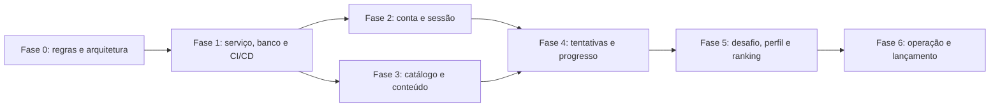

date: 11.11.2026
# Nublue — Plano de implementação do backend

> **Para quem for implementar:** usar `superpowers:subagent-driven-development` ou `superpowers:executing-plans`; seguir as decisões da Fase 0 antes de iniciar as fases seguintes. Marcar cada item após sua entrega e revisão.

**Objetivo:** substituir as regras e os dados locais do protótipo por uma API e persistência compartilhada, preservando a interface React/Vite existente.

**Arquitetura proposta:** manter o frontend atual e adicionar uma API REST independente, com PostgreSQL, autenticação e validação de atividades no servidor. Node.js com TypeScript é a opção inicial recomendada pelos documentos de contexto, mas o framework, o provedor e a hospedagem permanecem decisões da equipe.

**Tecnologias:** frontend atual: React, TypeScript e Vite. Backend e banco: ainda não configurados nem aprovados. Candidata para comparação: API Node.js/TypeScript + PostgreSQL.

**Contexto usado:** auditoria do repositório em 11/11/2026 e os arquivos `Nublue - Backlog.md` e `Nublue, funcionamento antigo e novo.md` enviados pelo usuário.

## Restrições globais

- Preservar React/Vite; migração de frontend depende de uma decisão registrada na Fase 0.
- O gabarito, a validação, a conclusão e a concessão de XP pertencem ao servidor.
- Segredos de runtime não podem entrar no código do frontend nem no repositório.
- Dados e visibilidade de estudantes menores precisam seguir as decisões de privacidade aprovadas antes de produção.

### Estrutura candidata se a API Node/TypeScript for aprovada

Os caminhos finais dependem da ADR; se outra opção for escolhida, preservar as mesmas fronteiras de responsabilidade.

```text
backend/
  src/server.ts                 # Inicialização e encerramento do serviço
  src/config/env.ts             # Validação de configuração de runtime
  src/db/migrations/            # Histórico reproduzível de schema
  src/modules/auth/             # Contas, sessão e recuperação
  src/modules/catalog/          # Cursos, lições e conteúdo público
  src/modules/attempts/         # Correção, tentativas e eventos de XP
  src/modules/progress/          # Progresso e sequências
  src/modules/challenges/       # Desafio diário
  src/modules/leaderboard/      # Consultas de ranking
  tests/                        # Testes de domínio, API e integração
```

## Resumo do estado atual

Não foi encontrado backend, schema de banco, migração, endpoint ou chamada HTTP da aplicação. O `package.json` só oferece `dev` e `build`; não há script de testes. O workflow `.github/workflows/ci.yml` instala dependências e executa o build do frontend.

| Área | Situação no repositório | O que isso significa para o backend |
|---|---|---|
| Landing page | Implementada em `src/app/features/landing/LandingPage.tsx` | A interface pública existe; cadastro e login reais continuam pendentes. |
| Login e cadastro | Modal e campos existem em `AuthDialog.tsx`; o submit não envia email ou senha para um serviço. Login apenas abre o app; cadastro guarda o nome localmente e inicia o diagnóstico. | Implementar contas, sessão, recuperação e integração com a interface. |
| Diagnóstico | `DiagnosticTest.tsx` apresenta seis cruzadinhas e retorna uma dificuldade ao fluxo local; resultado não é associado a uma conta. | Decidir se a dificuldade/resultados serão persistidos no perfil e em que nível de detalhe. |
| Jogo e conteúdo | Mecânicas jogáveis e 15 níveis estáticos em `src/app/data/levels.ts`, distribuídos por cinco capítulos. | Migrar conteúdo para catálogo validado e manter gabaritos no servidor. |
| Trilha | `SkillPathTab.tsx` calcula bloqueio no cliente: cada capítulo libera o primeiro nível e os seguintes dependem do anterior naquele capítulo. | Definir pré-requisitos e devolver estado de desbloqueio a partir do progresso persistido. |
| Progresso e XP | `useGameController.ts` confere respostas e atualiza XP no navegador; progresso é salvo em `localStorage`. O código mantém uma sequência de atividade e outra de desafios diários. | Servidor deve validar, registrar e conceder XP sem confiar no cliente; formalizar as duas regras ou consolidá-las. |
| Desafio diário | Gerado no cliente; progresso do jogo e da landing page usa chaves locais separadas. A data é baseada no fuso local do navegador; o desafio da landing não atualiza o XP do perfil. | Unificar regra, identidade do desafio, persistência e definição do dia no servidor. |
| Perfil e conquistas | Nome, estatísticas e conquistas são montados a partir de estado local em `App.tsx` e `ProfileTab.tsx`. | Vincular a uma conta e calcular/carregar dados persistidos. |
| Ranking | `RankingTab.tsx` combina `MOCK_PLAYERS` com XP local. O XP semanal do próprio usuário também usa o valor total. | Remover dados fictícios e definir períodos, desempates e exibição segura de apelidos. |
| CI e publicação | CI executa build; não há etapa de testes ou CD no workflow encontrado. | Integrar build/testes/migrações e planejar homologação, produção, health check e rollback. |

### O que já está concluído no frontend

- Estrutura por funcionalidades para jogo, aprendizagem, desafios, perfil, ranking e navegação.
- Landing page, diálogo visual de cadastro/login, teste diagnóstico, trilha, jogo, desafio, perfil e ranking.
- Quinze níveis de exemplo e gerador determinístico de desafios no cliente.
- Salvamento local de progresso e algumas preferências; isso é persistência de protótipo, não uma conta nem sincronização entre dispositivos.
- CI de build para o frontend.

### O que ainda não está concluído

Nenhuma funcionalidade de backend está implementada. Contas/sessões, API, banco, migrações, integração HTTP, gabarito protegido, validação no servidor, progresso multi-dispositivo, ranking real, painel/editor de conteúdo e publicação do backend continuam pendentes.

## Reconciliação dos documentos de contexto

Os textos enviados refletem mais de um momento do projeto e não coincidem integralmente com o código atual. Este plano usa o código como fonte de status: há uma landing page e `localStorage`; há 15 níveis nos cinco capítulos, não somente três níveis jogáveis e dois bloqueios de exemplo. Cadastro/login estão “feitos” apenas como interface, sem autenticação. A organização por funcionalidades e tokens de tema descrita como aplicada está presente no repositório.

O README cita Next.js, Node.js e PostgreSQL (com grafia incorreta “PostgreeDB”), enquanto a aplicação executa com Vite e não contém backend. A proposta Express + PostgreSQL do outro documento é uma sugestão, não uma decisão registrada. O plano não trata nenhuma dessas tecnologias como compromisso já aprovado.

## Abordagens consideradas

| Opção | Vantagem | Custo e risco | Situação |
|---|---|---|---|
| API REST independente mantendo o Vite | Preserva a interface existente e separa o ciclo de publicação do backend. Node/TypeScript + PostgreSQL é a candidata mais alinhada ao backlog. | Exige operar e proteger um serviço e um banco além do frontend. | **Recomendação provisória**; registrar decisão e hospedagem na Fase 0. |
| Migrar o frontend para Next.js e hospedar API junto | Pode concentrar frontend e rotas de servidor em uma aplicação. | Migração de uma SPA Vite existente, custo de mudança e deploy; não há requisito identificado que exija a migração. | Comparar na Fase 0; não iniciar sem justificativa concreta. |
| Backend gerenciado com autenticação e banco | Pode reduzir infraestrutura própria inicial. | Regras de respostas, XP, sessões diárias e privacidade ainda precisam de execução confiável no servidor; dependência de plataforma. | Comparar na Fase 0, sem escolher fornecedor antecipadamente. |

## Decisões necessárias antes da implementação

1. **Escopo do MVP e usuários:** quem cria a conta, se há conta de responsável e perfil de estudante separado, e quais dados são estritamente necessários.
2. **Privacidade:** apelido e visibilidade no ranking, participação opcional, exclusão da conta/dados e revisão das exigências aplicáveis ao público infantil antes do lançamento.
3. **Regras de aprendizagem:** conclusão, repetição, XP por atividade, pré-requisitos entre capítulos e diferença entre retry de rede da mesma tentativa e uma nova tentativa intencional.
4. **Calendário:** definição de sequência diária, fuso horário, janela semanal do ranking e duração do desafio (virada do dia ou 24 horas desde o início), inclusive após expiração.
5. **Desafio na landing page:** decidir se é demonstração anônima sem recompensa ou o mesmo desafio vinculado à conta; hoje são fluxos locais distintos.
6. **Dados existentes no navegador:** decidir se o progresso local do protótipo será descartado, importado uma vez ao criar conta ou ficará apenas no dispositivo.
7. **Conteúdo e administração:** decidir se o MVP usa conteúdo versionado/seed no repositório ou exige ferramenta de edição e publicação para administrador; definir escopo do curso piloto completo, com instruções e feedback.
8. **Stack e operação:** comparar API independente, migração para Next.js e serviço gerenciado; escolher linguagem/framework, banco, provedor, ambientes, segredos, estratégia de deploy e se recuperação por email entra no MVP e como será entregue.
9. **Diagnóstico:** decidir se a dificuldade resultante será salva no perfil e sincronizada entre dispositivos; limitar dados retidos ao que for necessário para a trilha.

**Entrega da Fase 0:** decisões registradas em ADR/requisitos do MVP, critérios de aceite por regra e matriz de dados permitidos. A recomendação deste plano não substitui essa aprovação da equipe.

## Modelo de domínio inicial

Validar o esquema depois da Fase 0. O conjunto de conceitos abaixo cobre as funcionalidades presentes e planejadas, sem fixar nomes finais de tabelas:

- **Conta e perfil:** credenciais/sessão, papel (por exemplo, responsável ou estudante se aprovado), apelido, preferências e status.
- **Catálogo:** curso, unidade, lição e atividade, com ordem, pré-requisitos, versão e conteúdo público.
- **Chave de resposta:** regra ou gabarito privado disponível somente ao serviço de validação; nunca incluído no endpoint público do exercício.
- **Tentativa e evento de XP:** respostas submetidas, resultado, tempo/data e concessão transacional de recompensa; identificador idempotente para evitar duplicação em reenvio.
- **Progresso:** conclusões e agregados usados pelo perfil/trilha, sempre reconciliáveis com tentativas e eventos.
- **Desafio diário:** data canônica, versão da atividade, estado e tentativas associadas à conta; regras de fuso definidas na Fase 0.
- **Ranking e conquistas:** posições calculadas sobre eventos válidos e regras documentadas; evitar armazenar um ranking que possa divergir da fonte de XP.

### Contratos HTTP candidatos

Usar estes recursos como ponto de partida para a especificação da API. Verbos, caminhos, formato de sessão e payloads finais devem ser fixados na Fase 0/ADR.

| Recurso candidato | Uso |
|---|---|
| `POST /auth/register`, `POST /auth/login`, `POST /auth/logout`, `POST /auth/recovery`, `POST /auth/recovery/complete` | Criar conta e administrar sessão/recuperação conforme regra de responsável aprovada; os dois últimos só se recuperação entrar no MVP. |
| `GET /me` | Retornar perfil e resumo de progresso da conta autenticada. |
| `GET /catalog/courses`, `GET /courses/{id}` | Carregar catálogo, unidades, lições e status de desbloqueio sem gabaritos. |
| `GET /lessons/{id}` | Carregar conteúdo público de uma lição disponível. |
| `POST /lessons/{id}/attempts` | Enviar respostas; validar no servidor e devolver resultado, XP realmente concedido e estado atualizado. |
| `GET /daily-challenge`, `POST /daily-challenge/attempts` | Carregar desafio do dia e registrar respostas/resultado segundo a regra aprovada. |
| `GET /leaderboard?period=weekly\|all` | Carregar ranking calculado pelo serviço com regras de período e apelidos aprovadas. |
| `GET /health` | Verificação operacional sem expor segredos ou dados privados. |

**Regra de confiança:** o cliente não envia um XP confiável, status de conclusão ou resultado final. O servidor calcula esses valores, autoriza cada conta sobre seus próprios dados e responde sem revelar chaves de resposta.

## Plano por fases

### Fase 0 — Fechar requisitos e arquitetura

- [ ] Consolidar casos de uso e IDs únicos para estudante, responsável e administrador/editor se aplicável.
- [ ] Aprovar escopo do MVP, modelo de contas infantis/responsável e dados mínimos.
- [ ] Documentar XP, repetição, sequência, ranking, desafio diário, fuso e pré-requisitos.
- [ ] Decidir importação ou descarte do progresso atual no `localStorage`.
- [ ] Comparar as três abordagens acima e registrar stack, banco, hospedagem, ambientes e gestão de segredos em ADR.
- [ ] Definir critérios verificáveis de MVP e conteúdo do curso piloto.
- [ ] Decidir se o resultado do diagnóstico (atualmente uma dificuldade) persiste na conta ou permanece local.

**Aceite:** a equipe consegue responder às nove decisões anteriores; modelo de conta, regras de XP/calendário, limites de privacidade, arquitetura, destino do diagnóstico e ambiente estão documentados antes de qualquer migração.

### Fase 1 — Fundação do serviço, banco e entrega

- [ ] Criar a estrutura do backend conforme a ADR, configuração por ambiente e endpoint de saúde.
- [ ] Preparar banco de desenvolvimento e primeira migração reproduzível a partir de um banco vazio.
- [ ] Adicionar fluxo local documentado para iniciar frontend, API e banco sem segredos versionados.
- [ ] Expandir CI para instalar/buildar frontend e backend e executar verificações automatizadas do backend.
- [ ] Configurar deploy de homologação, variáveis secretas no ambiente de execução, verificação de saúde e procedimento de rollback.
- [ ] Definir como migrações são aplicadas com segurança durante deploy.

**Aceite:** ambiente limpo sobe pela documentação; migrações são aplicáveis em sequência num banco vazio e o runner reconhece as já aplicadas sem repetir alterações; pipeline valida backend; homologação é publicada e verificável sem colocar segredos no bundle frontend.

### Fase 2 — Conta, sessão e perfil

- [ ] Implementar cadastro, login e logout conforme o modelo de estudante/responsável aprovado.
- [ ] Implementar os passos de recuperação por email somente se aprovados para o MVP; caso contrário, remover/ocultar esse caminho da interface até sua entrega.
- [ ] Armazenar credenciais com mecanismo de hash adequado à stack escolhida; limitar tentativas e validar entradas.
- [ ] Implementar autorização por conta e proteção dos dados de perfil.
- [ ] Implementar encerramento/exclusão de conta e política de dados conforme as decisões de privacidade.
- [ ] Substituir os callbacks simulados de `AuthDialog.tsx` por chamadas via módulo central de API.
- [ ] Carregar a identidade pelo backend em vez de tratar `nublue-user-name` como usuário autenticado.
- [ ] Salvar e recuperar a dificuldade resultante do diagnóstico se a Fase 0 aprovar persistência; caso contrário, mantê-la apenas como preferência local.
- [ ] Implementar tratamento de sessão expirada, erro de rede, formulário inválido e carregamento.

**Aceite:** cadastro/login/logout seguem os fluxos aprovados; se recuperação estiver no MVP, a pessoa consegue solicitar e concluir a redefinição; recarregar preserva sessão válida; conta A não lê/altera dados de conta B; email/senha não são ignorados após o submit; dificuldade do diagnóstico sincroniza entre dispositivos somente se esse comportamento for aprovado.

### Fase 3 — Catálogo e conteúdo protegido

- [ ] Definir schema/validação para curso, unidade, lição, atividade, grade, espaços, alternativas, regra de correção e recompensa.
- [ ] Migrar os 15 níveis e cinco capítulos atuais para formato inicial versionado/seed; revisar coerência matemática horizontal e vertical.
- [ ] Produzir o curso piloto completo conforme a Fase 0, com instruções, exercícios, feedback e progressão pedagógica revisados.
- [ ] Separar payload público de conteúdo privado de correção.
- [ ] Expor catálogo e conteúdo disponível pela API, incluindo estados de bloqueio calculados a partir das regras aprovadas.
- [ ] Substituir referências estáticas a `LEVELS` em `App.tsx`, `MainScreen.tsx`, `useGameController.ts` e `ProfileTab.tsx` por dados do catálogo.
- [ ] Migrar a apresentação do catálogo em `SkillPathTab.tsx`; deixar bloqueio individual por progresso para a integração da Fase 4.
- [ ] Definir se publicação/edição de novos conteúdos será seed no MVP ou ferramenta administrativa.

**Aceite:** conteúdo inválido é recusado com erro compreensível; API pública não retorna `answers`; catálogo apresenta os 15 níveis atuais e o curso piloto aprovado; Fase 3 informa disponibilidade inicial; desbloqueio individual após progresso fica para a Fase 4.

### Fase 4 — Tentativas, XP e progresso persistente

- [ ] Implementar envio e correção de respostas no servidor para lições e tentativas repetidas.
- [ ] Registrar tentativa e evento de XP em operação atômica; tornar reenvios idempotentes.
- [ ] Diferenciar retry de rede (mesma chave idempotente, uma recompensa) de nova tentativa intencional (novo registro, conforme regra de XP aprovada).
- [ ] Aplicar limites de frequência e validação de payload antes de expor endpoints de correção e recompensa.
- [ ] Persistir conclusões, atividade resolvida, XP, streak e resumo de progresso.
- [ ] Definir e implementar o cálculo da sequência com data/fuso do servidor segundo a Fase 0.
- [ ] Integrar `useGameController.ts` ao endpoint de tentativa e usar valores retornados como fonte de verdade.
- [ ] Integrar `SkillPathTab.tsx` aos desbloqueios personalizados recebidos com o progresso do aluno.
- [ ] Aplicar a política decidida para dados de `nublue-game-progress`, `nublue-daily-challenge-progress` e demais chaves legadas.

**Aceite:** adulterar valores enviados pelo cliente não altera XP; retry da mesma tentativa não duplica recompensa; nova tentativa segue a regra aprovada; atualização de página e login em outro dispositivo recuperam o progresso da conta e o desbloqueio da trilha; falha da API não marca lição como concluída.

### Fase 5 — Desafio diário, perfil, conquistas e ranking

- [ ] Definir uma fonte canônica para desafio diário e reconciliar desafio da landing e desafio autenticado.
- [ ] Persistir estado/tentativas do desafio e tornar resultado/XP idempotentes; responder a virada do dia conforme fuso definido.
- [ ] Servir resumo do perfil a partir de dados persistidos; mover critérios de conquistas para regras do domínio/backend.
- [ ] Remover `MOCK_PLAYERS`; fornecer ranking semanal e geral a partir de eventos de XP, com janela, empate e privacidade aprovados.
- [ ] Ajustar `ProfileTab.tsx`, `RankingTab.tsx`, `ChallengesTab.tsx` e `LandingPage.tsx` para estados reais da API.

**Aceite:** telas deixam de misturar mocks com dados pessoais; ranking semanal não usa XP total; desafio só concede recompensa conforme política aprovada; apelido/participação seguem as decisões de privacidade.

### Fase 6 — Conteúdo, segurança e operação de lançamento

- [ ] Implementar ferramenta administrativa de conteúdo se ela for requisito do MVP; caso contrário, documentar processo de seed/versionamento.
- [ ] Completar revisão de autorização, validação, limites de requisição e logs sem credenciais ou respostas sensíveis.
- [ ] Definir backup, retenção e procedimento testável de restauração do banco.
- [ ] Fazer revisão apropriada de privacidade para público infantil antes de produção.
- [ ] Revisar acessibilidade e estados de erro/carregamento da interface dependente da API.
- [ ] Completar CD com promoção para produção, verificação pós-deploy e rollback documentado.

**Aceite:** lançamento tem revisão de privacidade, operação de backup/recuperação documentada, monitoramento mínimo, pipeline reproduzível e fluxos principais cobertos por verificações automatizadas.

## Ordem e dependências



A landing page pode continuar evoluindo em paralelo, mas só deve anunciar cadastro/login como funcionais depois da integração da Fase 2. A fundação de CI/CD começa junto da API para que migrações e verificações não sejam adicionadas apenas no fim.

## Revisão de risco: casos que precisam de cobertura

1. **XP ou resposta adulterados no cliente:** servidor ignora totais enviados; testes da Fase 4 verificam cálculo e concessão do lado servidor.
2. **Reenvio após timeout ou clique repetido:** tentativas idempotentes; testes da Fase 4 confirmam uma única recompensa.
3. **Acesso cruzado entre contas:** autorização por proprietário; testes da Fase 2 tentam ler e alterar dados de outra conta.
4. **Mudança de data e fuso:** regra diária é calculada no servidor; testes da Fase 4/5 cobrem meia-noite, dia anterior e sessão retomada.
5. **Conteúdo inválido ou gabarito exposto:** validação do schema e contrato público; testes da Fase 3 cobrem grade inconsistente e ausência de chave de resposta.

## Fontes e evidências consultadas

- `README.md`, `package.json`, `src/main.tsx` e `.github/workflows/ci.yml` — stack, scripts e pipeline existentes.
- `src/app/App.tsx`, `src/app/features/landing/components/AuthDialog.tsx` e `LandingPage.tsx` — início do app, callbacks de autenticação e fluxo público.
- `src/app/data/levels.ts`, `src/app/features/learning/SkillPathTab.tsx` e `src/app/types/game.ts` — níveis, formato e bloqueio local.
- `src/app/features/game/useGameController.ts`, `src/app/features/challenges/dailyChallenge.ts` e `landingDailyProgress.ts` — validação local e persistência no navegador.
- `src/app/features/profile/ProfileTab.tsx`, `src/app/features/ranking/RankingTab.tsx` e `src/app/data/mockPlayers.ts` — perfil derivado e jogadores fictícios.
- `Nublue - Backlog.md` e `Nublue, funcionamento antigo e novo.md` — prioridades, decisões pendentes e histórico de mudanças descrito pelo projeto.

## Fora deste plano

- Implementar o backend agora: este arquivo é o planejamento solicitado.
- Escolher provedor ou inserir credenciais sem decisão da equipe.
- Enviar notificações push/email antes de definir regras, consentimento e necessidade no MVP.
- Construir CMS antes de confirmar que edição de conteúdo precisa estar no primeiro lançamento.
